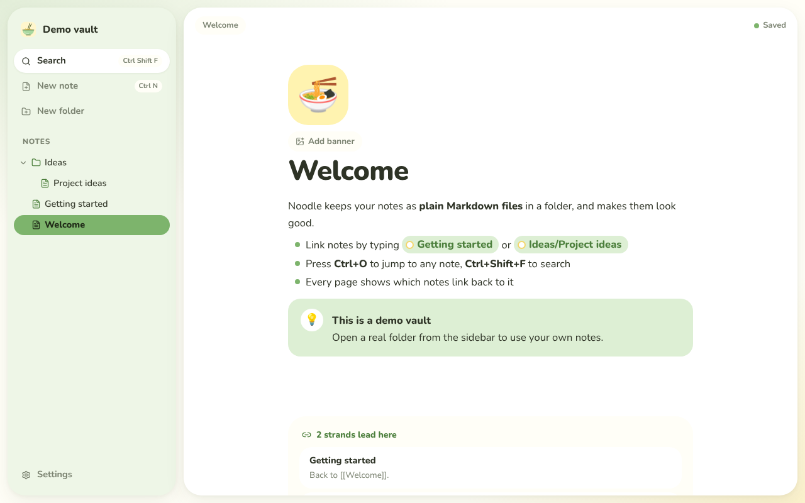
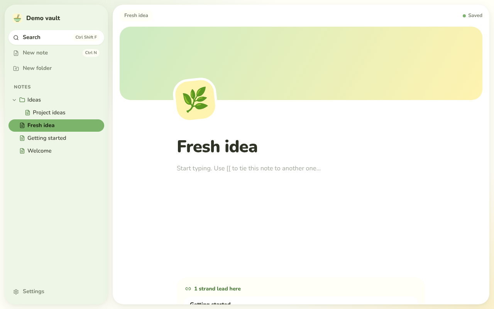
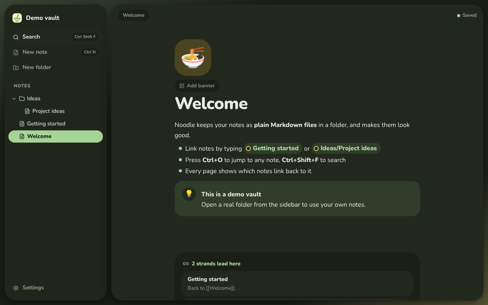

<p align="center"></p>

<h1 align="center">Noodle</h1>

<p align="center"><b>Every note is a strand. Noodle ties them together.</b><br>
A local-first notes app: your notes are plain Markdown files in a folder you own, connected to each other, and pleasant to look at.</p>

<p align="center"></p>

## Why Noodle

- **Your files, your computer.** A vault is just a folder of `.md` files. No account, no cloud, works offline, and any Markdown editor can still open your notes.
- **Connected notes.** Type `[[` to tie one note to another. Every page shows the strands that lead to it, and soon the whole bowl as a graph.
- **Soft, round and calm.** Rounded floating panels, emoji badges, pastel banners, bubbly callouts and checklists.
- **Make it yours.** Pastel green and yellow by default, with more palettes, your own accent colour, and light/dark mode.

<p align="center">
  
  
</p>

## Features (v0.1)

| | |
|---|---|
| Vault | Open any folder, file tree with folders, create/rename/trash notes (trash goes to `.trash/` in the folder, nothing is deleted outright) |
| Editing | Rich editor that reads and writes plain Markdown: headings, lists, checklists, quotes, code, links, images |
| Strands | `[[Note]]`, `[[Note#Heading]]`, `[[Note\|alias]]`, `![[Embed]]`; clicking a strand to a note that doesn't exist yet creates it |
| Backlinks | "Strands lead here" under every page |
| Callouts | `> [!tip] Title` blocks shown as round coloured bubbles |
| Page style | Emoji badge and banner stored in the note's frontmatter (`icon: 🍜`, `cover: garden`) |
| Find | Quick switcher (<kbd>Ctrl O</kbd>), full-text search (<kbd>Ctrl Shift F</kbd>) |
| Live | Edits made in other apps (or by sync tools, git…) show up instantly |
| Theme | 4 palettes, custom accent colour, light/dark/system (<kbd>Ctrl ,</kbd>) |
| Updates | One-click updates from GitHub releases |
| Motion | Banners unroll like a flag and knock the emoji badge askew |

## Roadmap

1. ~~Vault, editor, strands, backlinks, search, Windows installer~~ (v0.1)
2. Block editing: `/` menu, drag handles, toggles, columns, text colours
3. Graph view and canvas
4. Databases: table, board and calendar views over note properties
5. Page lock, hide and encrypt; AI assistant (bring your own API key or a local model)
6. Local REST API + MCP server + webhooks, so your other tools can use your notes
7. Phone ⇄ PC sync, with no server required

## Install

Download `Noodle_<version>_x64-setup.exe` from the [latest release](../../releases/latest) and run it. Windows may say "Windows protected your PC" because the app isn't code-signed yet: click **More info → Run anyway**.

After that you never need to download it again: Noodle checks for a new version when it starts, and an **Update** button appears in the sidebar (also in Settings). One click downloads the new version, installs it and reopens Noodle.

## Build from source

Requirements: [Node.js 20+](https://nodejs.org), [pnpm](https://pnpm.io), [Rust](https://rustup.rs) and the [Tauri prerequisites](https://v2.tauri.app/start/prerequisites/) for your OS (on Windows: Microsoft C++ Build Tools and WebView2, which Windows 11 already has).

```sh
pnpm install
pnpm tauri dev      # run the app with hot reload
pnpm tauri build    # make an installer in src-tauri/target/release/bundle/
```

`pnpm dev` alone runs the UI in a browser against a built-in demo vault, handy for working on the design.

Tests:

```sh
pnpm test                                         # editor and Markdown round-trip tests
cargo test --manifest-path src-tauri/Cargo.toml   # vault, strands, search
```

## How it's built

- **Desktop shell:** [Tauri 2](https://tauri.app) (Rust). Small installers, native file access.
- **UI:** React + TypeScript + Vite, with the Nunito typeface.
- **Editor:** [TipTap](https://tiptap.dev) (ProseMirror) with [tiptap-markdown](https://github.com/aguingand/tiptap-markdown), plus Noodle's own strand and callout nodes that round-trip to exactly the same Markdown.
- **Vault engine** (`src-tauri/src/vault.rs`): file tree, link index, link resolution (exact path first, then the shortest matching file name), backlinks, search and a folder watcher.

## License

[MIT](LICENSE)
